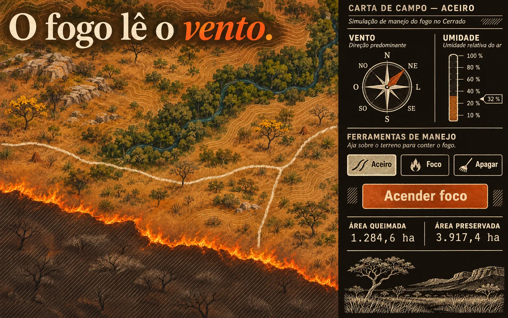
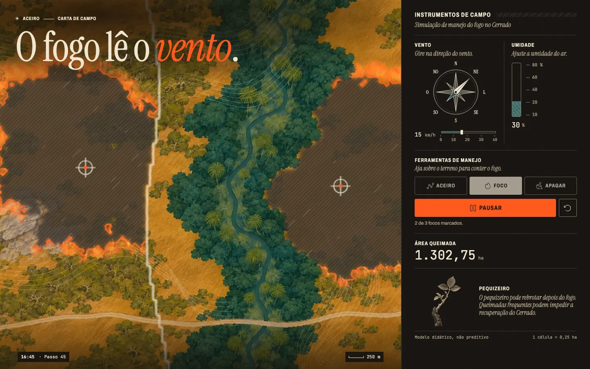
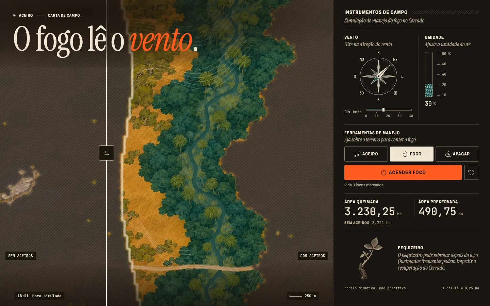

# Aceiro — ensaio do protocolo de direção artística (P10)

Experiência experimental, não é produto nem submissão. Repositório isolado: `/Users/arthurgoncalves/orca/experiments/aceiro` (branch `product/aceiro`, criado por `genesis:new` a partir de `dc4b5a1`). Assets: `/Users/arthurgoncalves/orca/experiments/aceiro-assets`.

**Tema:** propagação de fogo no Cerrado e o efeito de aceiros. **Mecanismo demonstrável:** autômato celular estocástico com semente sobre uma grade de combustível **extraída da própria ilustração gerada** (cor → classe de combustível), com contrafactual sem aceiros na mesma semente e comparação por máscara arrastável sobre o mapa.

| Conceito (Codex `image_gen`) | Entrega final, executando | Resultado com comparação |
|---|---|---|
|  |  |  |

Mobile: [executando](aceiro/executando-360.webp), [resultado](aceiro/resultado-mobile.webp). Estado inicial: [1440](aceiro/inicial-1440.webp).

## Como foi feito (tempos pelos commits, 24/11/2026)

| Passo | Quem | Duração |
|---|---|---|
| 1–4 problema, mecanismo, referências, direção ("carta de campo ao entardecer") | Claude | ~10 min |
| 5 conceito + 2 assets (terreno, espécime) | Codex `image_gen`, 1 tentativa cada | ~4 min |
| 6 DESIGN.md (tokens + seções de arte), fontes OFL, `fidelity.json`, spec | Claude | ~8 min |
| 7–9 implementação + autoverificação + 1ª revisão | Codex | ~14 min |
| Revisão visual de direção (capturas próprias durante a propagação) | Claude | ~5 min |
| Refinamento 2 (fogo suave com brilho, aceiro em giz contínuo, leituras ao vivo, escala de vento) | Codex | ~13 min |

Intervenções humanas: nenhuma. Intervenções do diretor de arte (Claude): uma rodada de 5 correções.

## Verificação (relatada pelo Codex e conferida por amostragem)

`check`, `typecheck`, `test` (277), `build`, `test:e2e` (13: teclado, pausa/retomada, desatualizado, reduced motion, 360/768/1440 sem overflow, axe antes/depois) e `design:verify` (145/145, 0 problemas globais) = 0. Medição local: 59,5 fps a 1440 × 900 com CPU 4× mais lenta (Chromium). As capturas foram inspecionadas pelo Claude; a simulação em andamento foi reproduzida pelo Claude com Playwright próprio. Citações da legenda botânica conferidas no Crossref (DOIs existentes e pertinentes). Mobile só em emulação.

## O que o ensaio mostrou

- **O conceito visual antes do código foi a alavanca principal.** A primeira implementação já reproduziu composição, escala e materiais do conceito; a divergência restante estava na camada computacional (fogo e aceiro em blocos), que nem `design:verify` nem os testes detectam — só a inspeção de capturas **durante** a interação.
- **Imagem gerada como dado** dá à simulação uma aparência impossível de obter com SVG simples e mantém o mecanismo honesto (a vereda segura o fogo porque está pintada como vereda).
- **O verificador de fidelidade** pegou o contrato tipográfico e de cor em todos os tamanhos; as regras de `data-*` deram ao implementador alvos explícitos.
- Componentes do Genesis praticamente não foram usados na tela; a fundação contribuiu com scaffold, motor de tokens/fontes, verificação e testes.

## Limitações

- n = 1, mesmo diretor e mesmo implementador; não há comparação cega com uma versão sem protocolo.
- O modelo é didático e não calibrado com dados reais; parcela e escala são fictícias.
- Trechos finos da estrada se confundem com capim na classificação por cor.
- Sem teste em dispositivo físico; arrastar no mapa em 360 px é apertado.
