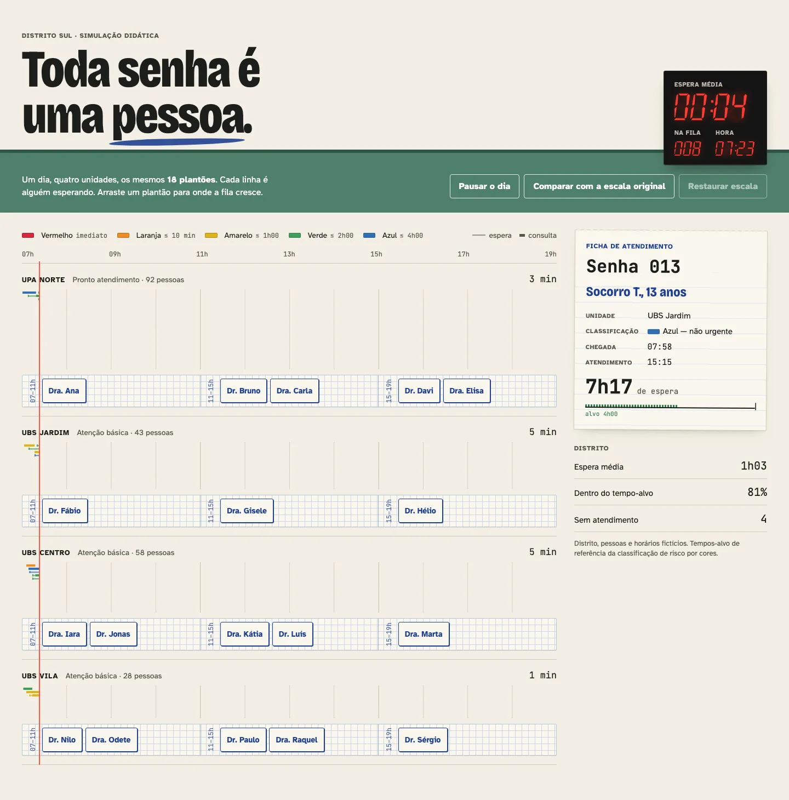
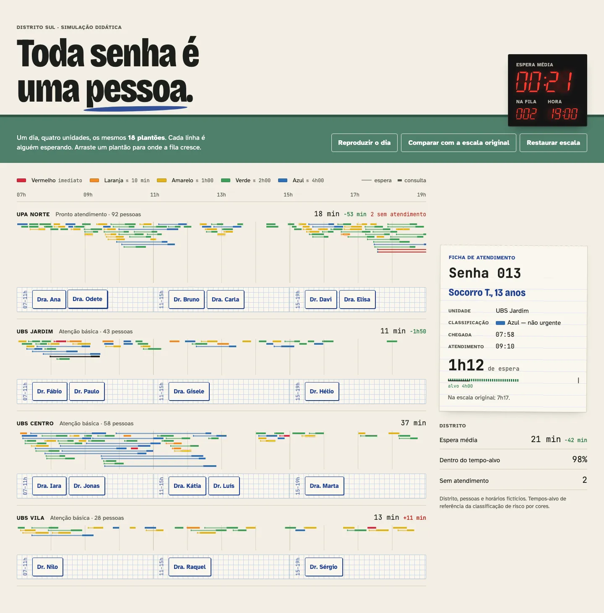
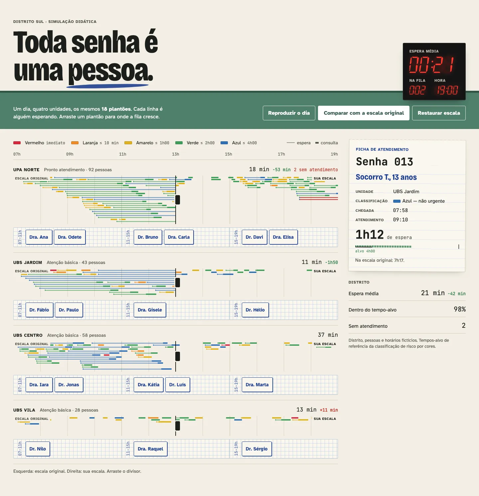

# Senha — tema surpresa sobre a Genesis Base

Ensaio de 24/11/2026. Tema escolhido pelo responsável entre cinco: **fila do SUS**. Primeiro produto criado com `bun run new` da [Genesis Base](https://github.com/agoncalvees/genesis-base). Não é produto nem submissão; distrito, pessoas e horários são fictícios.

| Dia em andamento (14 s, 07h→19h) | Após redistribuir 2 plantões | Comparação com a escala original |
|---|---|---|
|  |  |  |

Mobile: [redistribuída 360 px](senha/redistribuida-360.webp).

## O que foi construído

- **Direção:** "Toda senha é uma pessoa". A sala de espera vira linha do tempo. Referências: painel de senhas em LED, parede pintada até meia altura com o barrado verde e o gráfico de horários de trens de Marey (cada pessoa é uma linha). Tema claro, de propósito, o oposto do Aceiro.
- **Mecanismo:** fila com prioridade por cor de risco, simulada minuto a minuto em 4 unidades, com chegadas fixadas por semente. Os mesmos 18 plantões podem ser arrastados (ponteiro ou teclado) entre unidades e turnos. Escala original: espera média de 1h03. Movendo dois plantões: 21 min e 98 % dentro do tempo-alvo. A UBS Vila piora 11 min, e a interface mostra essa troca.
- **Momento-assinatura:** ao soltar um plantão, as linhas se reacomodam e o LED muda. A comparação usa o `CompareMask` da Base: escala original à esquerda, a do usuário à direita.
- Ficha de atendimento em papel para cada pessoa (ex.: "Socorro T., azul, 7h17 de espera; 1h12 com a sua escala"). Escala de plantão em papel quadriculado com caneta azul. Dígitos LED desenhados em SVG próprio.

## Como foi feito

| Etapa | Quem | Tempo de relógio |
|---|---|---|
| `bun run new` + fontes | Claude | ~1 min (validação do gerador: 7 s) |
| Passos 1–4 (público, mecanismo, referências, direção) e brief de assets | Claude | ~4 min |
| Assets via Codex | — | **bloqueado**: Codex atingiu o limite de uso (reset 00h10); sem compra de créditos |
| DESIGN.md + `fidelity.json` + modelo + interface + testes + 2 rodadas de revisão por captura | Claude Code sozinho | ~12 min até o commit `ea3224c` (21:57 → 22:09) |

Passo 5 (conceito visual) **não foi cumprido como imagem**: sem Codex e sem autorização para créditos do Figma, a composição foi decidida por escrito no DESIGN.md e validada em capturas sucessivas. A ilustração da sala de espera (brief pronto em `design/ASSET-BRIEF.md`) não foi gerada; o espaço na parede está reservado.

## Verificação

`check`, `typecheck`, `design:check`, `test` (121, incluindo 7 do modelo: prioridade, determinismo, conservação dos plantões, linhas sem sobreposição), `build` e `test:e2e` (10: teclado, Esc, navegação por pessoas, comparação, reduced motion, 360/768/1440 sem overflow, axe sem violações) = 0. `design:verify` com três estados (inicial, redistribuída, comparação): **873/873**.

Divergências encontradas pelas ferramentas e corrigidas antes da entrega:
- O `design:verify` pegou legendas de 13 px marcadas como corpo (o contrato pede ≥ 15 px). Passaram a ter atributo e regra próprios.
- O teste de fluxo pegou: com reduced motion o dia ainda tocava (preferência lida tarde demais); o arrasto com ponteiro não soltava; a comparação colapsava para altura 0.
- A revisão por captura pegou: a seleção inicial esmaecia um corredor inteiro; linhas finas demais; altura vazia em corredores com pouca fila; leituras dos corredores fora de sincronia com o LED durante a reprodução.

## O que voltou para a Base (commit `24b5949`)

O `lang` padrão do documento passou a ser `pt-BR`, a Bricolage agora carrega a variante de largura condensada, o `CompareMask` passou a herdar a altura do conteúdo e o Biome passou a ignorar `design/evidence/`.

## Leitura

- A Base funcionou como pretendido: o produto nasceu limpo e nada da fundação atrapalhou. Dela, a tela usou o motor de tokens e fontes, `useHydrated`, `CompareMask` e `design:verify`. O resto foi autoral.
- Sem geração de imagem, a qualidade veio da direção e do mecanismo. Falta materialidade de ilustração em comparação com o Aceiro. Gerar a ilustração após o reset do Codex é o próximo passo natural.
- O fluxo com um único agente (Claude Code) foi mais rápido que a orquestração do Aceiro, com qualidade comparável na camada de interação.
